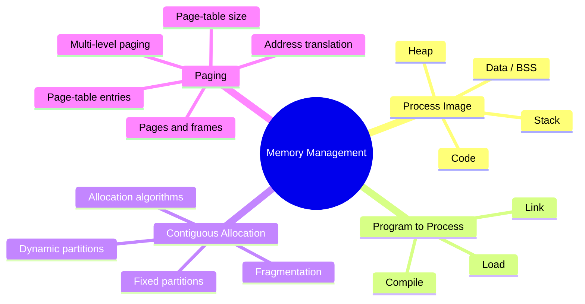
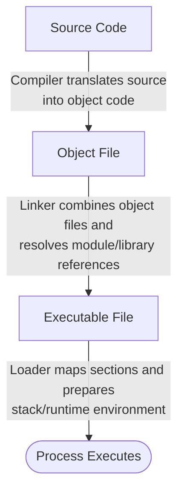
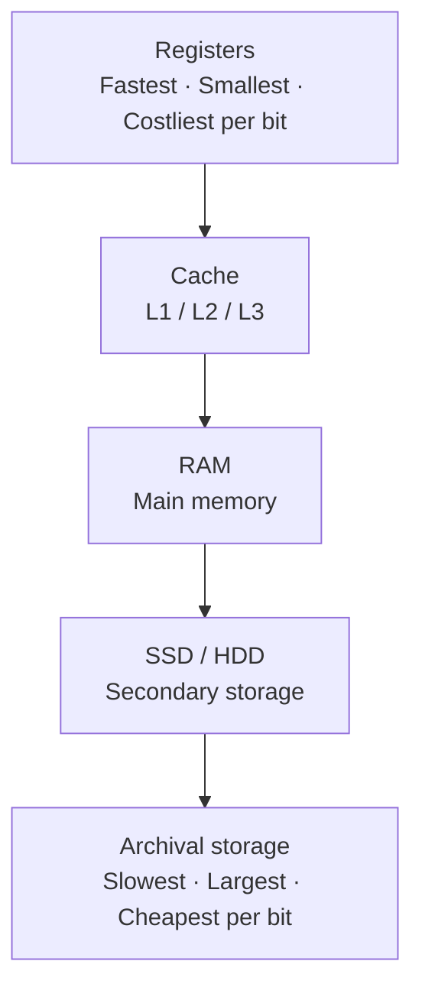
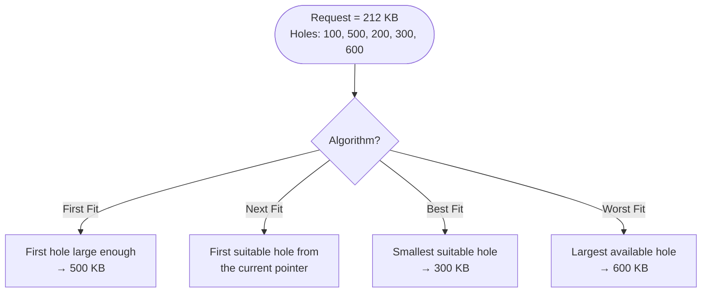
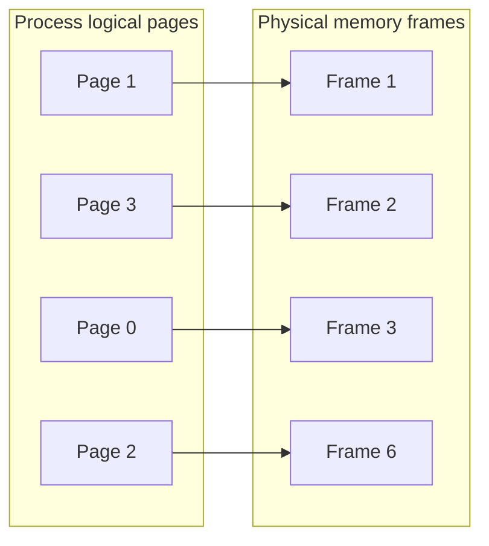
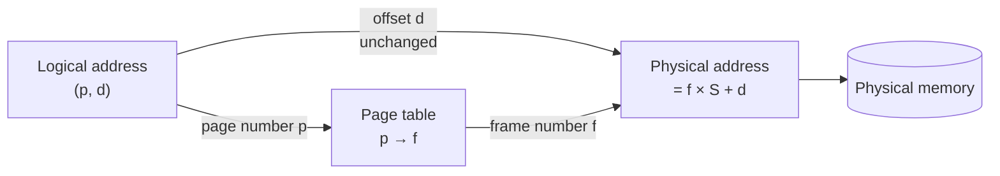
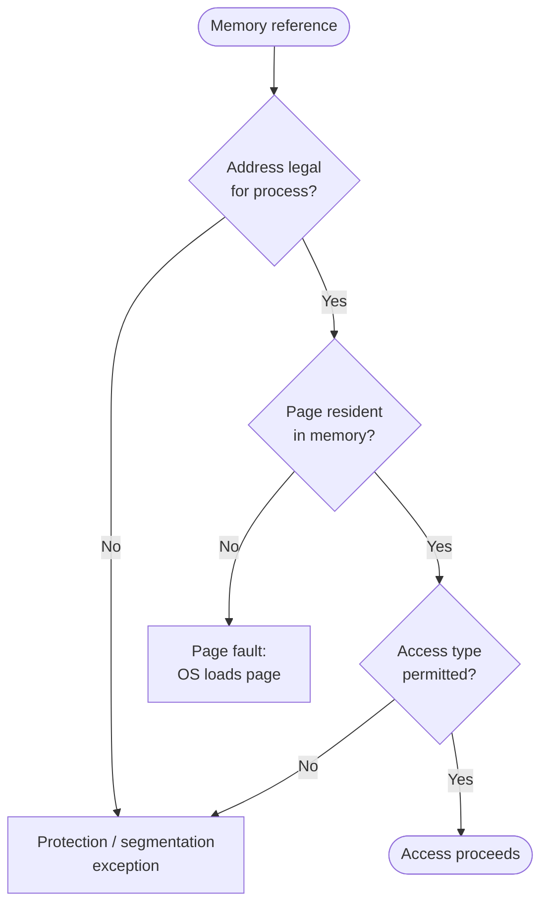
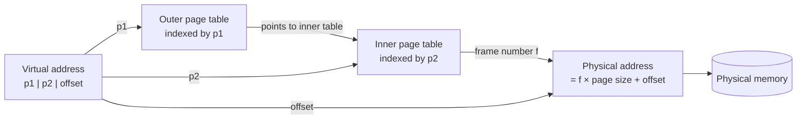
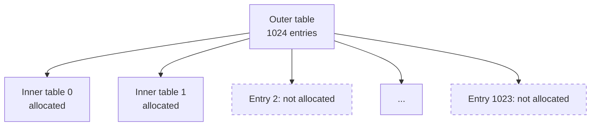

# Module 5 — Memory Management

**Structured College-Level Notes with Diagrams | Operating Systems**

> **Exam priority: Very High**
> Focus especially on memory-allocation numericals, fragmentation, paging address translation, page-table size, and multi-level paging.

---

## Table of Contents

1. [Learning Objectives](#1-learning-objectives)
2. [Process Memory Layout](#2-process-memory-layout)
3. [Process Creation Pipeline](#3-process-creation-pipeline)
4. [Memory Hierarchy — Quick Revision](#4-memory-hierarchy--quick-revision)
5. [Contiguous Memory Allocation](#5-contiguous-memory-allocation)
6. [Memory Allocation Algorithms](#6-memory-allocation-algorithms)
7. [Why Paging?](#7-why-paging)
8. [Paging Address Translation](#8-paging-address-translation)
9. [Page-Table Entries (PTEs)](#9-page-table-entries-ptes)
10. [Page-Table Size Calculations](#10-page-table-size-calculations)
11. [Multi-Level Paging](#11-multi-level-paging)
12. [Quick Formula Sheet](#12-quick-formula-sheet)
13. [Common GATE and College-Exam Traps](#13-common-gate-and-college-exam-traps)
14. [Practice Questions](#14-practice-questions)
15. [Final Revision Checklist](#15-final-revision-checklist)

---

## 1. Learning Objectives

By the end of this module, you should be able to:

- Explain process memory layout: code, data, heap, and stack.
- Describe compilation, linking, loading, and execution.
- Differentiate fixed and dynamic contiguous memory allocation.
- Calculate internal and external fragmentation.
- Apply First Fit, Next Fit, Best Fit, and Worst Fit.
- Translate logical addresses into physical addresses using paging.
- Calculate page-number bits, offset bits, frame counts, and page-table sizes.
- Explain valid bits, protection bits, and multi-level paging.

### Module Map



---

## 2. Process Memory Layout

A **process** is a program in execution. Its **process image** is the collection of memory regions associated with the running program.

### Diagram: Typical process memory layout

```text
             HIGHER ADDRESSES
        +---------------------------+
        | STACK                     |
        | Local variables, calls,   |
        | return addresses          |
        | grows downward     ↓      |
        +---------------------------+
        |                           |
        |     FREE ADDRESS SPACE    |
        |                           |
        +---------------------------+
        | HEAP                      |
        | Dynamic allocation        |
        | (malloc / new)      ↑     |
        | grows upward              |
        +---------------------------+
        | DATA / BSS                |
        | Global and static data    |
        +---------------------------+
        | CODE / TEXT               |
        | Program instructions      |
        +---------------------------+
             LOWER ADDRESSES
```

| Region | Stores | Typical behaviour |
|--------|--------|-------------------|
| **Code / Text** | Executable instructions | Often read-only and shareable |
| **Data** | Initialized global and static variables | Exists for the process lifetime |
| **BSS** | Uninitialized or zero-initialized global/static variables | Usually initialized to zero |
| **Heap** | Dynamically allocated objects | Commonly grows as memory is requested |
| **Stack** | Calls, parameters, return addresses, local variables | Stack frames pushed/popped as functions run |

> **Important:** This is a *conceptual* layout. Exact layout varies by OS and architecture; shared libraries and memory-mapped files may also appear. The heap often grows upward and the stack downward, but they do not necessarily meet.

### Example

Code = 180 KB, Data/BSS = 70 KB, Heap = 120 KB, Stack = 45 KB, Shared-library mappings = 85 KB.

Total mapped region size (assuming disjoint regions):

$$180 + 70 + 120 + 45 + 85 = 500\text{ KB}$$

If the heap grows by 30 KB and stack usage by 15 KB:

$$500 + 30 + 15 = 545\text{ KB}$$

This is a simplified sum; actual resident physical memory can be smaller because pages may be shared, not resident, or not yet touched.

---

## 3. Process Creation Pipeline

### Diagram: From source code to execution



- **Compiler:** Translates source code into object code.
- **Linker:** Combines object files and resolves references between modules/libraries.
- **Loader:** Creates the process image, maps required sections, prepares the initial stack/runtime environment, and transfers control.
- **Dynamic linking/loading:** Some libraries may be mapped or resolved at runtime.

---

## 4. Memory Hierarchy — Quick Revision

The memory hierarchy balances **speed, capacity, and cost**.



| Level | Examples | Speed | Capacity | Cost per bit |
|-------|----------|-------|----------|--------------|
| Registers | CPU registers | Fastest | Very small | Highest |
| Cache | L1, L2, L3 | Very fast | Small | High |
| Main memory | RAM | Fast | Medium/large | Moderate |
| Secondary storage | SSD/HDD | Slower | Very large | Lower |
| Archival storage | Tape/offline backup | Slowest access | Very large | Lowest |

**Locality of reference**

- **Temporal locality:** Recently accessed items are likely to be accessed again.
- **Spatial locality:** Addresses near a recently accessed address are likely to be accessed soon.
- RAM is **volatile**; SSD/HDD storage is **non-volatile**.
- Don't confuse the *memory hierarchy* (storage levels) with the *process memory layout* (address-space regions).

---

## 5. Contiguous Memory Allocation

In contiguous allocation, each process is placed in **one continuous block** of physical memory.

### 5.1 Fixed (static) partitioning

Memory is divided into fixed partitions *before* processes are assigned.

- **Equal-sized partitions:** Easy to manage, but a small process may waste space inside its partition.
- **Unequal-sized partitions:** Can match process sizes better, but internal waste may still occur.

**Internal fragmentation** is wasted space *inside* an allocated block.

$$\text{Internal fragmentation} = \text{Partition size} - \text{Process size}$$

Example: a 180 KB process in a 250 KB partition → $250 - 180 = 70$ KB.

```text
 Partition (250 KB)
 +----------------------------+--------------+
 |  Process (180 KB)          | Wasted 70 KB |
 +----------------------------+--------------+
                               ^ internal fragmentation
```

| Process | Partition | Internal fragmentation |
|--------:|----------:|-----------------------:|
| 90 KB | 100 KB | 10 KB |
| 180 KB | 200 KB | 20 KB |
| 250 KB | 300 KB | 50 KB |
| 400 KB | 424 KB | 24 KB |
| **Total** | **1,024 KB** | **104 KB** |

Partition-space utilization:

$$\frac{920}{1024} \times 100 \approx 89.84\%$$

This is utilization of *assigned partition capacity*, not necessarily total system memory.

### 5.2 Dynamic partitioning

A partition is created to fit a process request when it is loaded. This reduces internal waste from fixed partitions but may cause **external fragmentation**.

### Diagram: External fragmentation

```text
Physical memory
+----------+-----------+----------+-----------+----------+
| Free 2MB | Process A | Free 1MB | Process B | Free 3MB |
+----------+-----------+----------+-----------+----------+

Total free space = 2 + 1 + 3 = 6 MB
A 5 MB process still cannot fit into any single hole.
```

**External fragmentation:** Free space is split into separated holes. Total free space may be enough, but no single hole is large enough.

**Compaction:** Relocates processes so scattered free holes merge into one large free block.

```text
BEFORE COMPACTION
+----------+-----------+----------+-----------+----------+
| Free 2MB | Process A | Free 1MB | Process B | Free 3MB |
+----------+-----------+----------+-----------+----------+

                         |  compaction
                         v

AFTER COMPACTION
+-----------+-----------+-------------------------------+
| Process A | Process B |         Free 6 MB             |
+-----------+-----------+-------------------------------+
```

- ✅ **Advantage:** can create a sufficiently large contiguous block.
- ❌ **Disadvantages:** expensive, requires relocation support, consumes processing time.

**Overlays:** A historical technique where only the currently needed program portion is loaded, replacing another portion. Virtual memory is the more general modern approach.

### Internal vs External Fragmentation

| Internal fragmentation | External fragmentation |
|------------------------|------------------------|
| Waste **inside** an allocated block | Free space **scattered between** allocated blocks |
| Common with fixed-size allocation and the last page in paging | Common with variable-sized contiguous allocation |
| Compaction does **not** remove this internal waste | Compaction **can** reduce it |

---

## 6. Memory Allocation Algorithms

Assume free holes, in order:

$$[100,\ 500,\ 200,\ 300,\ 600]\text{ KB}$$

A process requests **212 KB**.

### Diagram: How the algorithms choose a hole



### Results for a 212 KB request

| Algorithm | Selection rule | Selected hole | Remainder | Updated holes (KB) |
|-----------|----------------|--------------:|----------:|--------------------|
| **First Fit** | First sufficient hole | 500 KB | 288 KB | `[100, 288, 200, 300, 600]` |
| **Next Fit** | First sufficient hole from current pointer | Depends on pointer; if starting at beginning, 500 KB | 288 KB in that case | Depends on pointer convention |
| **Best Fit** | Smallest sufficient hole | 300 KB | 88 KB | `[100, 500, 200, 88, 600]` |
| **Worst Fit** | Largest hole | 600 KB | 388 KB | `[100, 500, 200, 300, 388]` |

**Quick Fit:** Maintains separate free lists for common sizes/size classes. Fast for common requests, but needs extra bookkeeping and can complicate coalescing.

### Comparison

| Algorithm | Main advantage | Main limitation |
|-----------|----------------|-----------------|
| First Fit | Simple and often fast | Can leave small holes near the beginning |
| Next Fit | Doesn't always restart at the beginning | May perform worse than First Fit for some patterns |
| Best Fit | Minimizes immediate remainder in the selected hole | Can create many tiny unusable holes |
| Worst Fit | Leaves a larger remainder in the selected hole | May consume large holes needed later |
| Quick Fit | Fast for common sizes | More complex maintenance/coalescing |

> ⚠️ **Exam trap:** Best Fit does **not** guarantee the least fragmentation overall. It minimizes the immediate remainder for *one* allocation, not the long-term cost of a sequence of allocations.

### Worked multi-request example — First Fit

Initial holes: `[100, 500, 200, 300, 600]` KB. Requests: 212 KB, then 150 KB.

1. Allocate 212 KB from the 500 KB hole → remainder 288 KB. New holes: `[100, 288, 200, 300, 600]`
2. Scan from the beginning for 150 KB. The 100 KB hole is too small; the 288 KB hole fits → remainder 138 KB.

**Final holes: `[100, 138, 200, 300, 600]` KB**

```text
Start :  [100] [500] [200] [300] [600]
Req 212:  100   500→288  200   300   600     (First Fit picks 500)
Req 150:  100   288→138  200   300   600     (100 too small; 288 fits)
Final :  [100] [138] [200] [300] [600]
```

For Next Fit, the second search starts from the current pointer. The result depends on how the pointer is defined and updated; follow the convention given in the question.

---

## 7. Why Paging?

Contiguous allocation needs one continuous physical block. It may be hard to find a large enough hole even when total free memory is sufficient.

**Paging** lets a process be stored in **non-contiguous** physical memory:

- Logical memory is divided into fixed-size **pages**.
- Physical memory is divided into equally sized **frames**.
- Any page can be placed in any available frame.
- A **page table** maps page numbers to frame numbers.

### Diagram: Pages mapped to non-adjacent frames



**Page table:**

| Page no. | Frame no. |
|:--------:|:---------:|
| 0 | 3 |
| 1 | 1 |
| 2 | 6 |
| 3 | 2 |

### Advantages

- Eliminates external fragmentation for ordinary fixed-size page-frame allocation.
- A process doesn't need one contiguous physical block.
- Makes virtual memory and demand paging practical.

### Limitation: Internal fragmentation

A process may not fill its final page.

**Example:** Process = 10 KB; page size = 4 KB.

- Pages needed $= \lceil 10/4 \rceil = 3$
- Allocated capacity $= 3 \times 4 = 12$ KB
- Unused space in last page $= 12 - 10 = 2$ KB

```text
 Page 0 (4 KB)   Page 1 (4 KB)   Page 2 (4 KB)
 +-------------+ +-------------+ +--------+------+
 |    4 KB     | |    4 KB     | |  2 KB  | 2 KB |
 |    used     | |    used     | |  used  | free |
 +-------------+ +-------------+ +--------+------+
                                          ^ internal fragmentation
```

If process sizes are uniformly distributed relative to page boundaries, average final-page internal fragmentation is approximately **half a page**. This is an approximation, not a guarantee.

---

## 8. Paging Address Translation

### Key terms

| Term | Meaning |
|------|---------|
| **Logical / virtual address** | Address generated by the CPU |
| **Page number (p)** | Identifies the logical page |
| **Offset (d)** | Position within that page |
| **Frame number (f)** | Identifies the physical frame containing the page |
| **Page table** | Maps page numbers to frame numbers |
| **MMU** | Memory Management Unit; translates addresses and checks permissions |

### Diagram: Logical address to physical address



For byte-addressable systems with page size $S$ bytes:

$$p = \left\lfloor \frac{\text{Logical address}}{S} \right\rfloor \qquad d = \text{Logical address} \bmod S$$

$$\text{Physical address} = (f \times S) + d$$

When page size is a power of two:

$$\text{Offset bits} = \log_2(\text{page size in bytes})$$

$$\text{Page-number bits} = \text{Logical-address bits} - \text{Offset bits}$$

If the logical address space has $N$ pages, page-number bits $= \log_2 N$.

### Solved Numerical 1: Translate a logical address

**Given:** Page size = 1 KB = 1,024 bytes; page number $p = 2$, offset $d = 520$; page 2 maps to frame 6.

1. Page table gives $p = 2 \rightarrow f = 6$.
2. Physical address $= (6 \times 1024) + 520$
3. $= 6144 + 520 = 6664$ bytes

**Answer: 6,664 bytes.**

### Solved Numerical 2: Split a logical address

Logical address space $= 2^{20}$ bytes; page size $= 2^{10}$ bytes.

- Logical address bits $= 20$
- Offset bits $= \log_2(2^{10}) = 10$
- Page-number bits $= 20 - 10 = 10$
- Number of pages $= 2^{10} = 1024$

```text
+-----------------------+-----------------+
| Page number: 10 bits  | Offset: 10 bits |
+-----------------------+-----------------+
```

### Solved Numerical 3: Decimal logical address

Page size = 1 KB = 1,024 bytes; logical address = 2,500 bytes. Mappings: page 0 → frame 5; page 1 → frame 8; page 2 → frame 3.

1. Page number: $\lfloor 2500 / 1024 \rfloor = 2$
2. Offset: $2500 \bmod 1024 = 452$
3. Page 2 maps to frame 3.
4. Physical address: $(3 \times 1024) + 452 = 3524$ bytes

**Fast method:** $p = \lfloor LA/S \rfloor$ and $d = LA \bmod S$.

---

## 9. Page-Table Entries (PTEs)

A page-table entry typically stores a **frame number** plus **status/control bits**.

```text
 +--------------+---------+-------+------------+-----------+-------+
 | Frame number | Present | Valid | Protection | Referenced| Dirty |
 |              |  bit    | info  |  (R/W/X)   |   bit     |  bit  |
 +--------------+---------+-------+------------+-----------+-------+
```

| Field | Purpose |
|-------|---------|
| Frame number | Identifies physical frame |
| Present / resident bit | Whether the page is currently in physical memory |
| Validity information | May indicate whether the virtual page is legal for the process |
| Protection bits | Control read, write, execute |
| Referenced / accessed bit | Records whether the page has been accessed |
| Dirty / modified bit | Indicates whether the page has been modified |

Exact field names and meanings vary by architecture.

### Invalid vs not present

- In some textbook models, `valid = 1` means the page belongs to the process's valid address space; `valid = 0` means illegal.
- A **present/resident** bit indicates whether the page is currently in physical memory.
- A legal page that is *not resident* can cause a **page fault**, letting the OS bring it into memory.
- An illegal address or disallowed access may cause a protection/segmentation exception.
- **Always use the definitions specified in the question.**



**Protection example:** If page 1 is resident and read-only, reading is allowed, but writing causes a protection fault. Residency does not mean every access is permitted.

---

## 10. Page-Table Size Calculations

For a single-level page table with one entry per virtual page:

$$\text{Number of PTEs} = \frac{\text{Virtual address-space size}}{\text{Page size}}$$

$$\text{Page-table size} = \text{Number of PTEs} \times \text{PTE size}$$

### Solved Numerical

A 32-bit virtual address space uses 4 KB pages and 4-byte PTEs.

1. Virtual address space $= 2^{32}$ bytes
2. Page size $= 4\text{ KB} = 2^{12}$ bytes
3. Number of virtual pages $= 2^{32} / 2^{12} = 2^{20}$
4. Page-table size $= 2^{20} \times 4 = 2^{22}$ bytes $=$ **4 MiB**

This is the full single-level page table for the entire 32-bit virtual address space under these assumptions. A process may use only part of the address space, but this simple table still has an entry for every virtual page.

### Number of physical frames

$$\text{Frames} = \frac{\text{Physical memory size}}{\text{Frame size}}$$

**Example:** Physical memory = 1 GiB; frame size = 4 KB.

$$\frac{2^{30}}{2^{12}} = 2^{18} = 262{,}144\text{ frames}$$

---

## 11. Multi-Level Paging

### Why use it?

A large single-level page table can consume substantial memory even if a process uses only a small portion of its virtual address space. **Multi-level paging** divides the page table into levels; inner tables are allocated *as needed*, saving memory for sparse address spaces.

### Two-level paging example

**Given:** Virtual address = 32 bits; page size = 4 KB $= 2^{12}$ bytes; PTE size = 4 bytes.

1. Offset bits $= \log_2(4096) = 12$
2. Page-number bits $= 32 - 12 = 20$
3. Split the page-number bits into two 10-bit indexes.
4. Entries per inner table $= 2^{10} = 1024$
5. Size of each inner table $= 1024 \times 4 = 4096$ bytes $= 4$ KB

Each inner page table fits exactly into one 4 KB page. The outer table has 1,024 entries and also occupies 4 KB if represented by one full page.

### Diagram: Address format

```text
32-bit virtual address
+-----------------+-----------------+------------------+
|  p1: 10 bits    |  p2: 10 bits    |  offset: 12 bits |
+-----------------+-----------------+------------------+
```

### Diagram: Two-level page-table translation



- `p1` indexes the outer page table.
- `p2` indexes the selected inner page table.
- `offset` identifies the byte inside the physical frame.

### Why it saves memory (sparse address space)



Only the inner tables actually needed are kept in memory.

### Advantages and disadvantages

**Advantages**
- Avoids allocating inner page tables for unused address-space portions.
- Can reduce page-table memory for sparse processes.

**Disadvantages**
- Translation needs multiple lookups when there is no TLB hit.
- Extra memory accesses increase translation time.

A **TLB (Translation Lookaside Buffer)** caches recent address translations to reduce this cost.

---

## 12. Quick Formula Sheet

| What to calculate | Formula |
|-------------------|---------|
| Offset bits | $\log_2(\text{page size in bytes})$ |
| Page-number bits | Logical-address bits − offset bits |
| Number of virtual pages | Virtual address-space size ÷ page size |
| Number of physical frames | Physical memory size ÷ frame size |
| Page number from logical address | $\lfloor LA / S \rfloor$ |
| Offset from logical address | $LA \bmod S$ |
| Physical address | $(f \times S) + d$ |
| Internal fragmentation | Allocated partition size − process size |
| Number of PTEs | Virtual address-space size ÷ page size |
| Page-table size | Number of PTEs × PTE size |
| Number of pages needed | $\lceil \text{process size} / \text{page size} \rceil$ |
| Paging's last-page waste | Allocated page capacity − process size |

> **Unit reminder:** Keep units consistent. Address translation uses bytes. State whether sizes use KB/MB or KiB/MiB. In binary calculations: 1 KiB = 1,024 bytes, 1 MiB = $2^{20}$ bytes, 1 GiB = $2^{30}$ bytes.

---

## 13. Common GATE and College-Exam Traps

1. **Internal vs external fragmentation:** Internal waste is inside an allocated block; external fragmentation is scattered free space.
2. **Paging doesn't remove all fragmentation:** It eliminates external fragmentation for ordinary fixed-size page-frame allocation, but the last page may contain unused space.
3. **Offset bits depend on page size:** For 4 KB pages, offset bits $= \log_2(4096) = 12$.
4. **Logical and physical addresses differ:** The page number is translated through the page table; the offset remains unchanged.
5. **Use the correct frame:** Physical-address calculation uses the *frame* number from the page table, not the page number.
6. **Best Fit is not universally best:** It minimizes the immediate leftover in one chosen hole, not necessarily overall fragmentation.
7. **Next Fit depends on the pointer:** State where the search begins and how the pointer is updated.
8. **Check valid offsets:** If a segment limit is 800 bytes and offsets start at zero, valid offsets are 0 through 799.
9. **PTE bits vary by model:** Distinguish legal/valid address information from whether a page is resident.
10. **Multi-level paging trade-off:** It can save page-table memory for sparse spaces, but adds extra translation steps on a TLB miss.
11. **Use ceilings for page counts:** A 10 KB process with 4 KB pages needs 3 pages, not 2.5.
12. **Don't mix KB conventions:** In textbook powers-of-two problems, 4 KB normally means 4,096 bytes.

---

## 14. Practice Questions

*Try these before looking up solutions.*

### Conceptual

1. Differentiate code, data, heap, and stack.
2. Explain compilation, linking, and loading.
3. Differentiate fixed and dynamic partitioning.
4. Compare internal and external fragmentation with examples.
5. Explain compaction and its disadvantages.
6. Compare First Fit, Next Fit, Best Fit, and Worst Fit.
7. Explain why paging permits non-contiguous allocation.
8. What information can a page-table entry contain?
9. Why is multi-level paging useful for sparse address spaces?
10. Explain the trade-off between multi-level paging and TLBs.

### Numerical

**Q1. Allocation algorithms:** Free holes are 100 KB, 500 KB, 200 KB, 300 KB, and 600 KB. Allocate requests of 212 KB, 150 KB, and 350 KB using First Fit, Best Fit, and Worst Fit separately. Show the remaining holes after each request.

**Q2. Paging translation:** Page size = 2 KB, logical address = 5,000 bytes, and page table maps page 2 to frame 7. Calculate page number, offset, and physical address.

**Q3. Address bits:** A system has a 36-bit virtual address and 8 KB pages. Calculate offset bits, page-number bits, and number of virtual pages.

**Q4. Page-table size:** A 32-bit virtual address space uses 4 KB pages and 8-byte PTEs. Calculate number of PTEs and full single-level page-table size in MiB.

**Q5. Multi-level paging:** A 32-bit system has 4 KB pages and 4-byte PTEs. Page-number bits are divided into two 10-bit indexes. Show the address format and calculate the size of each page table.

**Q6. Internal fragmentation:** A 10 KB process is loaded using 4 KB pages. Calculate pages required, allocated capacity, and internal fragmentation in the final page.

**Q7. Physical address:** Page size = 1 KB. Page 0 maps to frame 4, page 1 to frame 6, page 2 to frame 3, and page 3 to frame 8. Translate logical address 3,100 bytes.

**Q8. Physical frames:** Physical memory is 2 GiB and frame size is 8 KB. Calculate the number of frames and the frame-number bits needed to identify them.

---

## 15. Final Revision Checklist

- [ ] Draw and explain the process memory layout.
- [ ] Calculate internal fragmentation.
- [ ] Explain external fragmentation and compaction.
- [ ] Trace First Fit, Next Fit, Best Fit, and Worst Fit across multiple requests.
- [ ] Convert a logical address into page number and offset.
- [ ] Translate a logical address using a page table.
- [ ] Calculate offset bits, page-number bits, frame counts, and page-table size.
- [ ] Explain valid/resident and protection information in a PTE.
- [ ] Solve two-level paging numericals.
- [ ] Explain the trade-off between multi-level paging and TLBs.

> **Highest-priority numerical topics:** allocation algorithms, paging address translation, address-bit calculations, page-table size, and two-level paging.
