# Module 6 — Virtual Memory

**College-Level Notes | Operating Systems**

> **Exam priority: Very High**
> Most important numerical topics: **TLB/EMAT**, **page-fault overhead**, **FIFO/LRU/Optimal replacement**, and **Belady's anomaly**.

---

## Table of Contents

1. [Why Virtual Memory?](#61-why-virtual-memory)
2. [Translation Lookaside Buffer (TLB)](#62-translation-lookaside-buffer-tlb)
3. [Page-Fault Handling](#63-page-fault-handling)
4. [Combined TLB and Page-Fault Numericals](#64-combined-tlb-and-page-fault-numericals)
5. [Page Replacement Algorithms](#65-page-replacement-algorithms)
6. [Worked Page-Replacement Numerical](#66-worked-page-replacement-numerical)
7. [Belady's Anomaly and Stack Algorithms](#67-beladys-anomaly-and-stack-algorithms)
8. [Frame Allocation](#68-frame-allocation)
9. [Thrashing](#69-thrashing)
10. [Practical Replacement Implementations](#610-practical-page-replacement-implementations)
11. [Segmentation and Segmented Paging](#611-segmentation-and-segmented-paging)
12. [Formula Sheet](#612-formula-sheet)
13. [Common GATE / Exam Traps](#613-common-gate-and-college-exam-traps)
14. [Practice Questions](#614-practice-questions)
15. [Final Revision Checklist](#final-revision-checklist)

---

## Learning Objectives

By the end of this module, you should be able to:

- Explain virtual memory, demand paging, and locality of reference.
- Calculate Effective Memory Access Time (EMAT) with a TLB.
- Explain page faults and calculate effective access time with page-fault probability.
- Apply FIFO, LRU, and Optimal page-replacement algorithms.
- Identify Belady's anomaly and explain stack algorithms.
- Explain thrashing, working sets, and frame allocation.
- Describe practical replacement approaches: NRU, Second Chance, Clock, LFU.
- Compare paging, segmentation, and segmented paging.

### Module Map

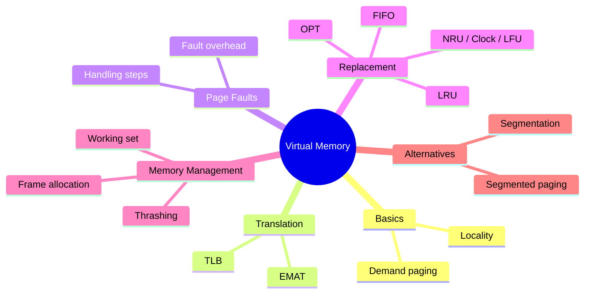

---

## 6.1 Why Virtual Memory?

**Virtual memory** allows a process to execute without keeping its entire address space in physical RAM at the same time. The OS and hardware map virtual addresses to physical memory and use secondary storage when needed.

### Why it is useful

- A process can have a virtual address space **larger** than the available physical memory.
- Only needed pages are loaded, reducing unnecessary I/O.
- More processes can be kept active at once.
- Each process has its own virtual address space → better **isolation and protection**.

> ⚠️ Virtual memory does **not** make storage as fast as RAM. A page fault needing disk/SSD I/O can be thousands to millions of times slower than a normal memory access.

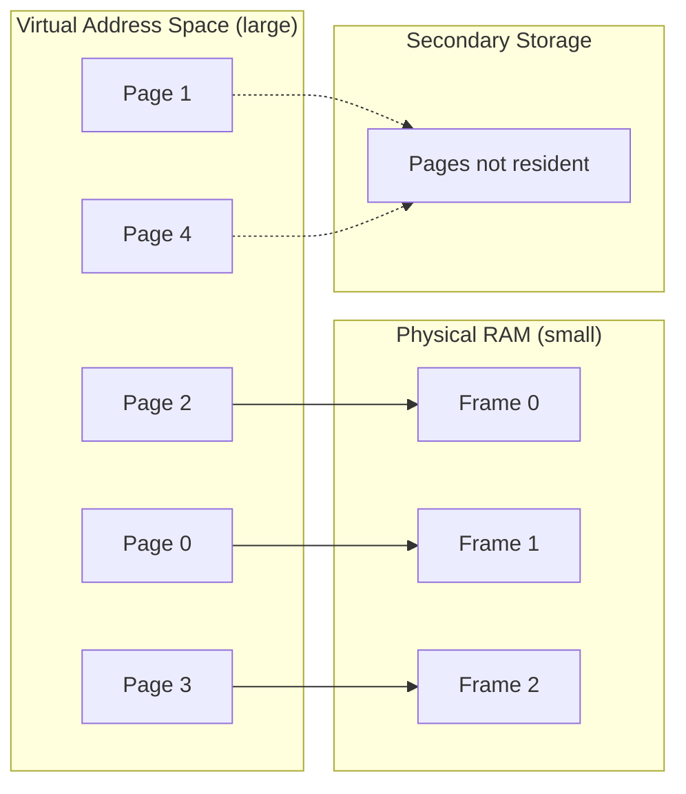

### Demand paging

**Demand paging** loads a page into RAM only when it is first needed, instead of loading every page before execution.

1. The CPU generates a virtual address.
2. The MMU/TLB and page table translate it.
3. If the page is resident and access is permitted, execution continues.
4. If the page is valid but **not resident**, a page-fault exception transfers control to the OS.
5. The OS locates the page, obtains a free frame (or selects a victim), and loads the page.
6. The OS updates the page table and **restarts the faulting instruction**.

### Locality of reference

Demand paging works because programs access a relatively small set of pages during a short period.

| Type | Meaning | Example |
|------|---------|---------|
| **Temporal locality** | Recently accessed item is likely to be accessed again soon | A loop counter |
| **Spatial locality** | Nearby addresses are likely to be accessed soon | Traversing an array |
| **Sequential locality** | A common spatial pattern: memory accessed in order | Reading a file/array start to end |

### Translation and page-fault overview

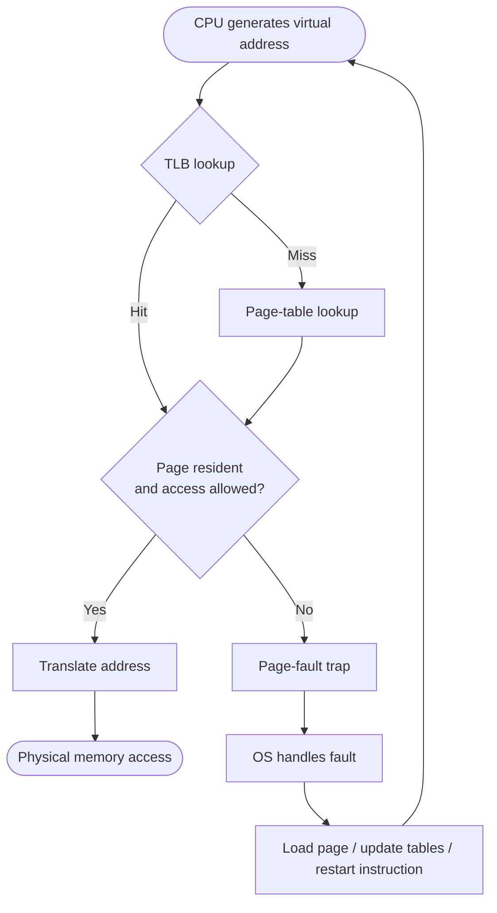

> **Key point:** A TLB miss is **not** automatically a page fault. The page may be in RAM; its translation just isn't cached in the TLB.

---

## 6.2 Translation Lookaside Buffer (TLB)

A **TLB** is a small, fast cache storing recent **virtual-page → physical-frame** translations.

### Why it is needed

Without a TLB, a simple page-table translation needs:

1. One memory access to read the page-table entry.
2. Another memory access to read/write the requested data.

The TLB lets most references skip the page-table memory access.

### TLB hit and miss

- **TLB hit:** Translation found in the TLB.
- **TLB miss:** Not found → page-table lookup (simple model).
- **Page fault:** The page is not resident (or another fault condition). *Different from a TLB miss.*

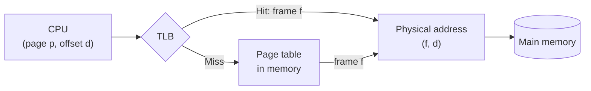

### Standard EMAT formula

**Assumptions:**
- $t$ = TLB lookup time
- $m$ = one main-memory access time
- $h$ = TLB hit ratio
- No page faults; serial TLB lookup; single-level page table in memory

| Case | Time |
|------|------|
| Hit | $T_{hit} = t + m$ |
| Miss | $T_{miss} = t + 2m$ |

$$
\begin{aligned}
EMAT &= h(t+m) + (1-h)(t+2m)\\
&= \boxed{t + (2-h)\,m}
\end{aligned}
$$

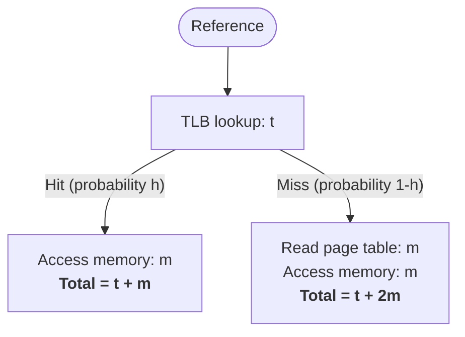

### Solved Numerical 1

Given: $t = 20$ ns, $m = 100$ ns, $h = 0.80$

- Hit time $= 20 + 100 = 120$ ns
- Miss time $= 20 + 100 + 100 = 220$ ns

$$
EMAT = 0.8(120) + 0.2(220) = 96 + 44 = \boxed{140\text{ ns}}
$$

> **Important:** TLB lookup time is included in **both** hit and miss cases in this serial-lookup model.

### Solved Numerical 2: Find the hit ratio

Given: $t = 10$ ns, $m = 80$ ns, measured EMAT $= 106$ ns.

$$
\begin{aligned}
106 &= 10 + (2-h)(80)\\
96 &= 160 - 80h\\
80h &= 64\\
\boxed{h = 0.80 = 80\%}
\end{aligned}
$$

### Alternative hardware timing models

Some problems assume the TLB lookup **overlaps** memory access rather than being serial. The formula then changes. **Always use the timing assumptions stated in the question.** The formula above is for serial lookup.

---

## 6.3 Page-Fault Handling

A **page fault** occurs when a translation/memory access cannot complete normally. A common case: a valid virtual page that is not currently resident.

### Page-fault handling steps

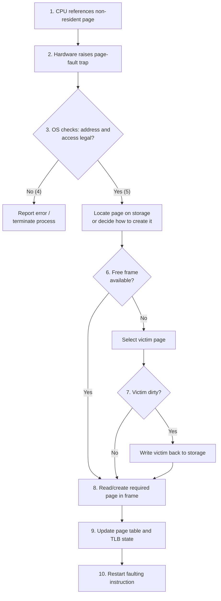

> A page fault does **not always** need disk I/O. Some are resolved with zero-filled pages, copy-on-write, or pages already cached in memory.

### Page-fault effective access time

Let:
- $p$ = probability that a reference causes a page fault
- $m$ = normal memory access time
- $F$ = *additional* page-fault service time (excluding the normal access counted separately)

$$
\boxed{EMAT = m + pF}
$$

> Simplified model. If a problem defines fault-service time differently, avoid double-counting or omitting the normal memory access.

### Solved Numerical 3

Given: $m = 100$ ns, $p = 0.001$, $F = 8$ ms $= 8{,}000{,}000$ ns

$$
EMAT = 100 + (0.001)(8{,}000{,}000) = 100 + 8000 = \boxed{8{,}100\text{ ns} = 8.1\ \mu s}
$$

Page-fault overhead dominates even though only 1 in 1,000 references faults.

### Solved Numerical 4: Maximum acceptable page-fault rate

Normal access = 100 ns, additional fault service = 5 ms. Find max $p$ if EMAT must not exceed 150 ns.

$$
\begin{aligned}
150 &= 100 + p(5{,}000{,}000)\\
p &= \frac{50}{5{,}000{,}000} = \boxed{10^{-5}}
\end{aligned}
$$

### Unit conversions

| Conversion | Value |
|------------|-------|
| 1 µs | 1,000 ns |
| 1 ms | 1,000 µs = 1,000,000 ns |

> Convert **all** terms to the same unit before calculating EMAT.

---

## 6.4 Combined TLB and Page-Fault Numericals

First compute normal EMAT from the TLB model, then add expected page-fault overhead (if $F$ is defined as additional).

$$
\boxed{EMAT_{overall} \approx t + (2-h)m + pF}
$$

**Assumptions:** serial TLB lookup, one-level page table, $F$ is additional fault cost, $p$ is per memory reference. Detailed models may separate TLB misses, faults, dirty write-back, and restart costs.

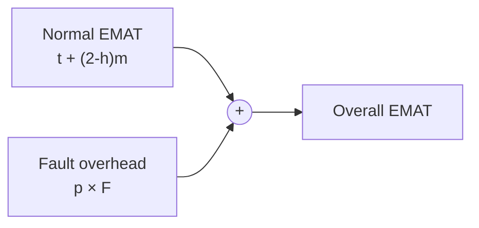

### Solved Numerical 5

Given: $t = 10$ ns, $m = 100$ ns, $h = 0.95$, $p = 10^{-5}$, $F = 4$ ms $= 4{,}000{,}000$ ns

- Normal EMAT: $EMAT_0 = 10 + (2 - 0.95)(100) = 115$ ns
- Fault overhead: $pF = 10^{-5} \times 4{,}000{,}000 = 40$ ns

$$
\boxed{115 + 40 = 155\text{ ns}}
$$

> ❌ **Common mistake:** Don't add the full fault-service time to every reference. Multiply it by the fault probability, and make sure $p$ and $F$ use compatible assumptions.

---

## 6.5 Page Replacement Algorithms

When a fault occurs and no frame is free, the OS must choose a resident page to remove — the **victim page**.

- A **dirty** victim must be written back (extra overhead).
- A **clean** victim backed by storage can simply be discarded.
- Goal: usually minimize page faults or total cost.

### Reference string

A **reference string** is the sequence of page numbers requested by a process.

```text
7, 0, 1, 2, 0, 3, 0, 4
```

If frames start empty, the first reference to each page is always a fault.

### A. FIFO — First In, First Out

Evicts the page that has been resident the **longest**.

- Pages kept in arrival order; evict the oldest on a fault with full frames.
- Simple to implement.
- May evict a heavily used page just because it's old.
- **Can exhibit Belady's anomaly.**

```text
 Queue (oldest → newest)
 ┌────┐   ┌────┐   ┌────┐
 │ P7 │ → │ P0 │ → │ P1 │   ← new page enters here
 └────┘   └────┘   └────┘
   ↑
 victim on next fault
```

### B. Optimal (OPT / MIN)

Evicts the page whose **next use is farthest in the future**.

- Gives the **minimum possible faults** for a known string and fixed frames.
- Needs future knowledge → mainly a theoretical benchmark.
- Does **not** exhibit Belady's anomaly.

### C. LRU — Least Recently Used

Evicts the page **not used for the longest time in the past**.

- Uses recent history to predict future use.
- Implemented via timestamps, stack/list, or approximations.
- Does **not** exhibit Belady's anomaly.
- Exact LRU needs significant tracking overhead.

```text
 LRU stack (top = most recent)
 ┌────────┐
 │  P1    │  ← most recently used
 │  P0    │
 │  P7    │  ← least recently used = victim
 └────────┘
```

### Replacement comparison

| Algorithm | Victim choice | Uses | Belady's anomaly? |
|-----------|---------------|------|-------------------|
| FIFO | Oldest loaded page | Arrival order | **Possible** |
| OPT | Farthest next use | Future knowledge | No |
| LRU | Least recently used | Past history | No |

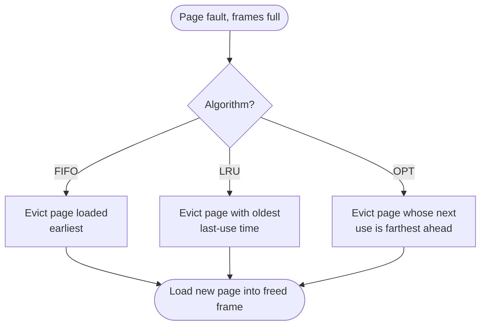

---

## 6.6 Worked Page-Replacement Numerical

Reference string (20 references), **3 frames**, initially empty:

```text
7, 0, 1, 2, 0, 3, 0, 4, 2, 3, 0, 3, 2, 1, 2, 0, 1, 7, 0, 1
```

### FIFO trace

`F` = fault, `H` = hit. Slots are replaced in round-robin order (oldest first).

| # | Ref | Frame 1 | Frame 2 | Frame 3 | Result |
|--:|:---:|:-------:|:-------:|:-------:|:------:|
| 1 | 7 | 7 | — | — | F |
| 2 | 0 | 7 | 0 | — | F |
| 3 | 1 | 7 | 0 | 1 | F |
| 4 | 2 | **2** | 0 | 1 | F |
| 5 | 0 | 2 | 0 | 1 | H |
| 6 | 3 | 2 | **3** | 1 | F |
| 7 | 0 | 2 | 3 | **0** | F |
| 8 | 4 | **4** | 3 | 0 | F |
| 9 | 2 | 4 | **2** | 0 | F |
| 10 | 3 | 4 | 2 | **3** | F |
| 11 | 0 | **0** | 2 | 3 | F |
| 12 | 3 | 0 | 2 | 3 | H |
| 13 | 2 | 0 | 2 | 3 | H |
| 14 | 1 | 0 | **1** | 3 | F |
| 15 | 2 | 0 | 1 | **2** | F |
| 16 | 0 | 0 | 1 | 2 | H |
| 17 | 1 | 0 | 1 | 2 | H |
| 18 | 7 | **7** | 1 | 2 | F |
| 19 | 0 | 7 | **0** | 2 | F |
| 20 | 1 | 7 | 0 | **1** | F |

**Total FIFO faults = 15** (5 hits, 15 faults).

> 📝 *Note:* The step-by-step frame contents in this table were re-traced from the FIFO rule (oldest page evicted). The final count of 15 matches the original notes.

### Results summary (3 frames)

| Algorithm | Page faults |
|-----------|:-----------:|
| FIFO | **15** |
| LRU | **12** |
| OPT | **9** |

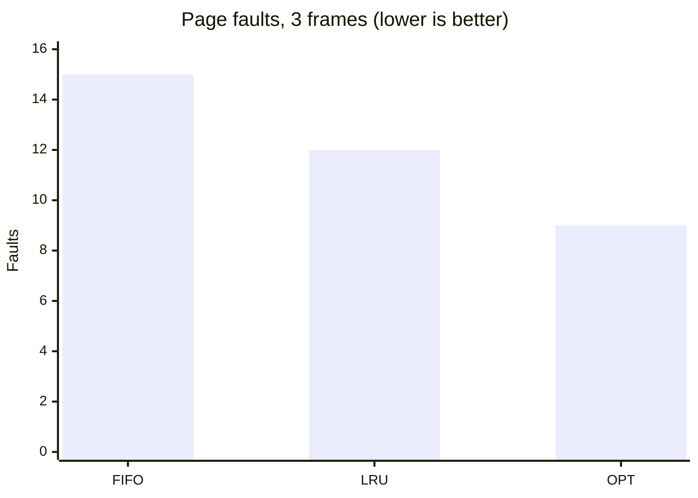

### Manual-solving checklist

1. Draw one row per reference.
2. Mark hits **without** replacing anything.
3. On each fault, apply **only** the chosen algorithm's rule.
4. Count **all** faults, including the first reference to each page.

> **Important:** Don't mix FIFO arrival order with LRU recency order — they pick victims differently.

---

## 6.7 Belady's Anomaly and Stack Algorithms

### Belady's anomaly

Increasing the number of frames causes **more** page faults for a given algorithm and reference string. It can occur with **FIFO**.

### Classic example

Reference string:

```text
1, 2, 3, 4, 1, 2, 5, 1, 2, 3, 4, 5
```

| Frames | FIFO page faults |
|:------:|:----------------:|
| 3 | 9 |
| 4 | **10** ← more frames, more faults! |

```mermaid
xychart-beta
    title "Belady's anomaly (FIFO)"
    x-axis ["3 frames", "4 frames"]
    y-axis "Page faults" 0 --> 12
    line [9, 10]
```

### Stack algorithms

An algorithm has the **stack property** if the set of resident pages with $n$ frames is always a **subset** of the set with $n+1$ frames, for the same reference history.

```text
   Pages with n frames  ⊆  Pages with n+1 frames
   ┌───────────────┐      ┌─────────────────────┐
   │  { A, B, C }  │  ⊆   │   { A, B, C, D }    │
   └───────────────┘      └─────────────────────┘
```

| Algorithm | Stack property? | Belady's anomaly? |
|-----------|:---------------:|:-----------------:|
| LRU | Yes | No |
| OPT | Yes | No |
| FIFO | Not generally | **Can occur** |

> ⚠️ **GATE trap:** Don't assume more frames always reduce faults. The guarantee depends on the algorithm.

---

## 6.8 Frame Allocation

When several processes run concurrently, the OS decides how many frames each gets.

### Equal allocation

With $m$ frames and $n$ processes:

$$
\boxed{\frac{m}{n}\text{ frames per process}}
$$

### Proportional allocation

For a process of size $s_i$:

$$
\boxed{a_i = \frac{s_i}{\sum_j s_j} \times m}
$$

- $a_i$ = frames for process $i$
- $s_i$ = size / page demand of process $i$
- $m$ = total frames available

**Example:** 120 frames; processes of 10,000, 20,000 and 30,000 pages. Total = 60,000.

| Process | Size | Calculation | Frames |
|:-------:|-----:|-------------|-------:|
| P1 | 10,000 | 10,000/60,000 × 120 | **20** |
| P2 | 20,000 | 20,000/60,000 × 120 | **40** |
| P3 | 30,000 | 30,000/60,000 × 120 | **60** |
| | | **Check: 20 + 40 + 60** | **120** ✓ |

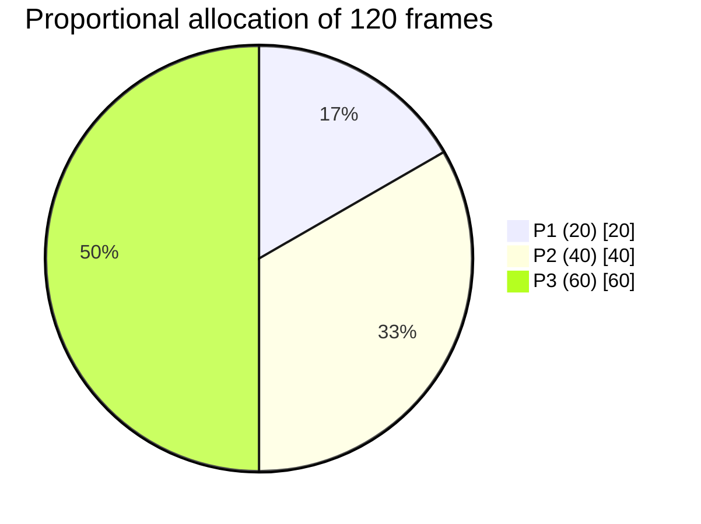

### Local vs global replacement

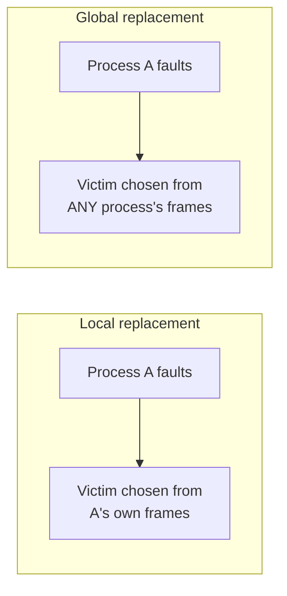

| | Local | Global |
|--|-------|--------|
| Victim from | Process's own pages | Any process's pages (global pool) |
| Effect on others | No direct frame loss | May reduce others' frames |
| Trade-off | More isolation | Better overall utilization, but one process's pressure affects others |

---

## 6.9 Thrashing

**Thrashing** occurs when the system spends so much time handling page faults and moving pages that little useful work is completed.

### Why it happens

1. Too many processes compete for frames.
2. Processes get fewer frames than their active references need.
3. Pages are evicted and needed again soon.
4. Page faults and storage I/O rise sharply.
5. CPU utilization can fall (processes wait for paging I/O).
6. The OS may mistakenly **increase** multiprogramming because CPU use is low — making it worse.

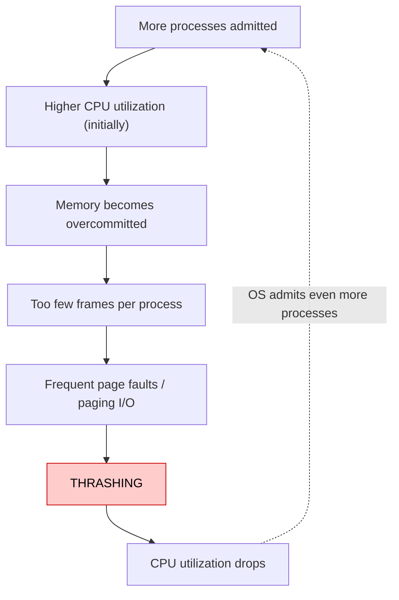

Typical shape of CPU utilization vs. degree of multiprogramming:

```text
 CPU
 util.
  │            ╭──────╮
  │          ╱         ╲
  │        ╱             ╲
  │      ╱                 ╲___
  │    ╱                        ╲___  ← thrashing
  │  ╱
  └──────────────────────────────────────
      Degree of multiprogramming →
```

### Working-set model

The **working set** is the set of **distinct** pages referenced during a recent window $\Delta$:

$$
W(t,\Delta) = \text{set of pages referenced in the most recent window } \Delta
$$

$$
\boxed{|W(t,\Delta)| = \text{number of distinct pages in the window}}
$$

**Example:** window = `2, 3, 2, 5, 6, 3, 5, 8, 6, 2`

- Distinct pages: $\{2, 3, 5, 6, 8\}$
- Working-set size: $\boxed{5\text{ pages}}$

If the process gets substantially fewer than 5 frames, it may repeatedly fault on pages in its working set. Actual thrashing depends on workload and system conditions, not just this count.

### Working-set frame demand

$$
\boxed{D = \sum_{i=1}^{n} |W_i|}
$$

If $D$ exceeds available frames, the system can't hold all working sets at once → the OS may suspend one or more processes.

**Example:** working sets 180, 220, 150.

$$
D = 180 + 220 + 150 = 550\text{ frames}
$$

With only 500 frames: shortfall $= 550 - 500 = \boxed{50\text{ frames}}$

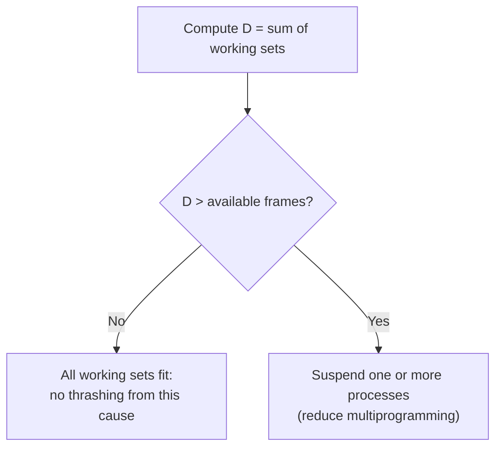

### Page-Fault Frequency (PFF)

PFF controls frame allocation by monitoring each process's fault rate.

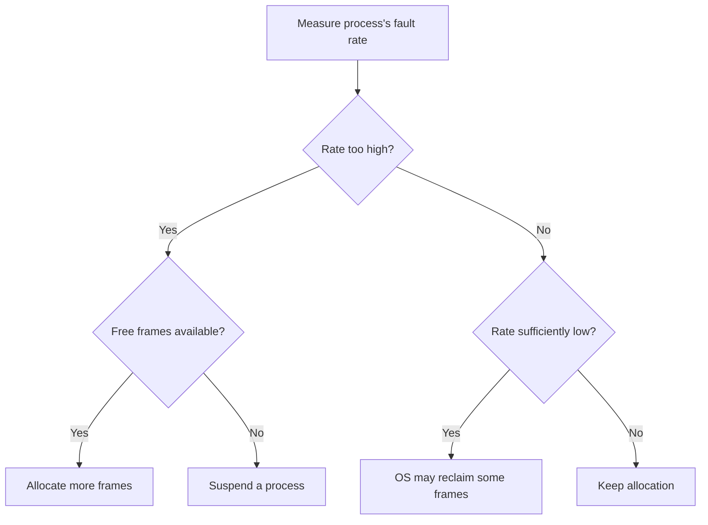

$$
\boxed{\text{Page-fault rate} = \frac{\text{page faults}}{\text{references}}}
\qquad
\boxed{\text{PFF \%} = \frac{\text{faults}}{\text{references}} \times 100\%}
$$

**Example:** 40 faults in 2,000 references → $PFF = \frac{40}{2000} = 0.02 = \boxed{2\%}$

Whether 2% is too high depends on OS policy, storage latency, and workload.

---

## 6.10 Practical Page-Replacement Implementations

### NRU — Not Recently Used

Uses two bits: **R** (referenced recently) and **M** (modified/dirty).

| Class | R | M | Meaning |
|:-----:|:-:|:-:|---------|
| 0 | 0 | 0 | Not recently referenced, clean ← **best victim** |
| 1 | 0 | 1 | Not recently referenced, dirty |
| 2 | 1 | 0 | Recently referenced, clean |
| 3 | 1 | 1 | Recently referenced, dirty ← **worst victim** |

NRU picks a victim from the **lowest-numbered non-empty class**; within a class, the choice may be arbitrary.

### Second Chance

FIFO plus a reference-bit check:

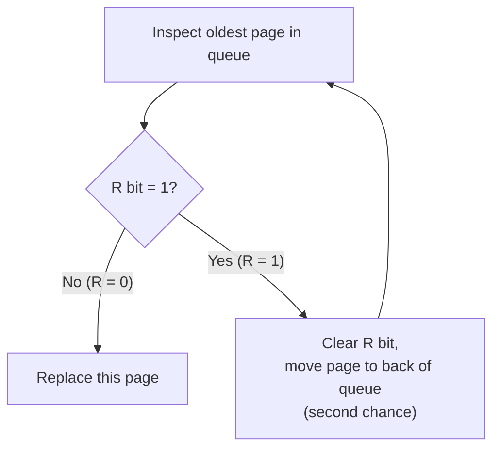

### Clock algorithm

Clock implements Second Chance with a **circular list** and a moving **hand**.

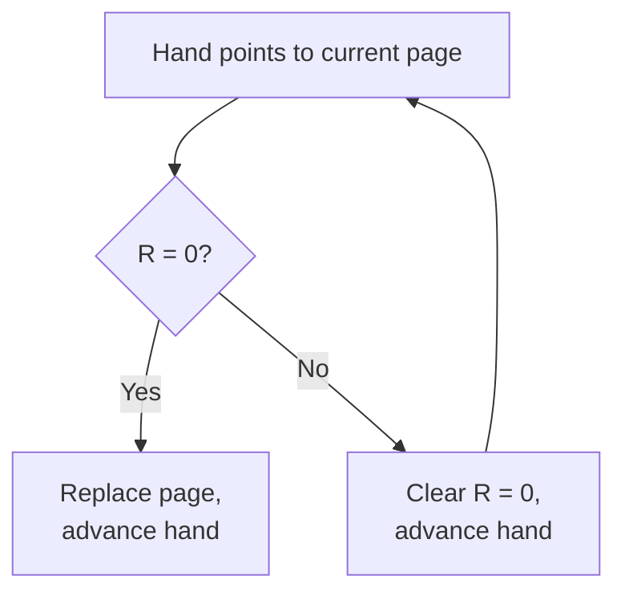

```text
          ┌───────┐
      ┌───│ P1 R=1│───┐
      │   └───────┘   │
  ┌───────┐       ┌───────┐
  │ P4 R=0│       │ P2 R=1│
  └───────┘       └───────┘
      │   ┌───────┐   │
      └───│ P3 R=0│───┘        ◄── hand moves clockwise
          └───────┘
```

### LRU implementation ideas

- **Timestamp/counter:** record last-access time; evict the oldest timestamp.
- **Stack/list:** move page to MRU position on every reference; evict from the LRU end.
- Exact tracking is expensive → practical systems use **approximations**.

### LFU — Least Frequently Used

Replaces the page with the **smallest reference count**.

| Page | Count |
|:----:|:-----:|
| P1 | 8 |
| P2 | **3** |
| P3 | 6 |
| P4 | **3** |

P2 and P4 tie at the lowest count → a tie-breaker (e.g., LRU) is needed.

> **Caution:** A simple LFU counter can keep pages that were popular long ago but are no longer useful. Implementations may use **aging/decay**.

---

## 6.11 Segmentation and Segmented Paging

### Segmentation

Divides a process into logical, **variable-sized** regions (code, data, stack). Logical address = `(segment number, offset)`.

Each segment-table entry stores a **base** and **limit**:

$$
\boxed{PA = \text{base} + \text{offset}} \quad\text{provided}\quad \boxed{0 \le \text{offset} < \text{limit}}
$$

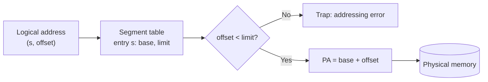

**Example:** base = 4,000; limit = 800; offset = 300. Since $300 < 800$:

$$
PA = 4000 + 300 = \boxed{4300}
$$

Offset **800** is **invalid** when the limit is 800 (offsets start at 0).

### Segmented paging

Each logical segment is divided into fixed-size pages. Translation:

1. Segment number → that segment's page table.
2. Page number → physical frame.
3. Offset → byte within the frame.

For logical address $(s, p, d)$ where page $p$ of segment $s$ maps to frame $f$:

$$
\boxed{PA = (f \times \text{page size}) + d}
$$

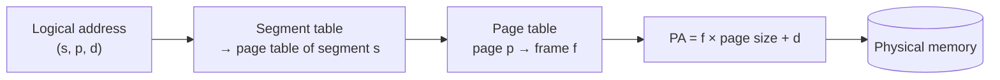

### Paging vs segmentation

| Feature | Paging | Segmentation |
|---------|--------|--------------|
| Division | Fixed-size pages | Variable-size logical segments |
| Logical address | Page number + offset | Segment number + offset |
| Mapping | Page table | Segment table (base + limit) |
| External fragmentation | Avoided for fixed-size frames | Can occur |
| Internal fragmentation | Possible in the last page | Not inherent in the same way |
| Programmer visibility | Usually transparent | Often reflects program structure |

Segmented paging combines logical segmentation with page-based physical allocation: it avoids external fragmentation in physical allocation while keeping separate logical segments.

---

## 6.12 Formula Sheet

| Quantity | Formula |
|----------|---------|
| TLB hit time | $t + m$ |
| TLB miss time (single-level) | $t + 2m$ |
| EMAT with TLB | $h(t+m) + (1-h)(t+2m) = t + (2-h)m$ |
| EMAT with page faults | $m + pF$ (if $F$ is additional) |
| Combined TLB + faults | $t + (2-h)m + pF$ (under stated assumptions) |
| Page-fault rate | Faults ÷ references |
| PFF percentage | (faults / references) × 100% |
| Working-set size | Number of distinct pages in recent window |
| Total working-set demand | Sum of working-set sizes |
| Proportional frame allocation | $(s_i / \sum s_j) \times m$ |
| Segmentation physical address | Base + offset, if offset < limit |
| Segmented paging physical address | Frame × page size + offset |

---

## 6.13 Common GATE and College-Exam Traps

1. **TLB miss ≠ page fault.** A page can be resident even if its translation isn't in the TLB.
2. **Include TLB lookup time in both cases** (serial-lookup model).
3. **Check the problem's EMAT model** — serial vs overlapped.
4. **Convert units first** (ms/µs → ns when memory time is in ns).
5. **Multiply fault service time by fault probability**; never add it for every reference.
6. **Count cold-start faults** — first reference to each page faults when frames start empty.
7. **Don't mix replacement rules** — FIFO: arrival order; LRU: past recency; OPT: future references.
8. **Belady's anomaly can occur with FIFO**; LRU and OPT are stack algorithms and don't show it.
9. **More frames don't guarantee fewer faults for every algorithm** — FIFO is the counterexample.
10. **Thrashing = excessive paging relative to useful execution.** High fault activity alone isn't enough to diagnose it.
11. **Working set counts distinct pages**, not references.
12. **NRU: pick the lowest non-empty class**, not the smallest page number.
13. **Segmentation: test the limit first.** Offset equal to the limit is out of bounds.
14. **Segmented paging: use the physical frame number** in the PA formula, not segment/page number.

---

## 6.14 Practice Questions

*Try these without looking at the worked examples.*

### Conceptual

1. Explain virtual memory and demand paging.
2. Differentiate temporal and spatial locality.
3. Distinguish a TLB miss from a page fault.
4. Explain the page-fault handling routine.
5. Compare FIFO, LRU and Optimal page replacement.
6. Define Belady's anomaly and explain why FIFO can exhibit it.
7. Explain the stack property of LRU and OPT.
8. Explain thrashing and the working-set model.
9. Compare local and global page replacement.
10. Explain NRU, Second Chance, Clock, and LFU.
11. Differentiate paging, segmentation and segmented paging.
12. Explain why a high page-fault rate sharply increases effective access time.

### Numerical

**Q1. TLB EMAT:** TLB lookup = 10 ns, memory access = 80 ns, hit ratio = 90%. Calculate EMAT (serial lookup).

**Q2. Find hit ratio:** TLB lookup = 5 ns, memory access = 100 ns, measured EMAT = 125 ns. Find the hit ratio.

**Q3. Page faults:** Memory access = 100 ns, fault probability = $10^{-5}$, additional fault service = 5 ms. Calculate EMAT.

**Q4. Combined EMAT:** TLB = 10 ns, memory = 100 ns, hit ratio = 95%, fault probability = $10^{-5}$, additional fault service = 4 ms. Calculate approximate overall EMAT.

**Q5. FIFO/LRU/OPT:** With 3 frames, initially empty, count page faults for each algorithm:
`1, 2, 3, 1, 4, 2, 5, 1, 2, 3, 4, 5`

**Q6. Belady's anomaly:** For FIFO and `1, 2, 3, 4, 1, 2, 5, 1, 2, 3, 4, 5`, calculate page faults with 3 and 4 frames.

**Q7. Working set:** Recent window `1, 2, 1, 3, 4, 2, 5, 3, 1`. Find distinct pages and working-set size.

**Q8. Working-set demand:** Three processes need 200, 250 and 180 frames; the system has 600 frames. Calculate total demand and surplus/shortfall.

**Q9. PFF:** 60 page faults in 3,000 references. Calculate page-fault rate and percentage.

**Q10. Frame allocation:** Allocate 120 frames proportionally to processes with demands 10,000, 20,000 and 30,000.

**Q11. NRU:** Pages A, B, C, D have (R, M) = (1,1), (0,1), (0,0), (1,0). Classify each and identify the preferred replacement class.

**Q12. Segmentation:** Base = 7,000, limit = 1,000, offset = 750. Find the physical address and state whether offset 1,000 is valid.

---

## Final Revision Checklist

- [ ] Explain demand paging and locality.
- [ ] Calculate TLB hit, miss, and EMAT.
- [ ] Calculate page-fault overhead using consistent units.
- [ ] Trace FIFO, LRU and OPT accurately.
- [ ] Identify Belady's anomaly and stack algorithms.
- [ ] Calculate working-set size and total frame demand.
- [ ] Explain thrashing and PFF-based responses.
- [ ] Classify pages for NRU and trace Second Chance/Clock.
- [ ] Solve frame-allocation numericals.
- [ ] Translate segmentation and segmented-paging addresses.

> **Highest-priority revision:** TLB/EMAT, page-fault probability, FIFO/LRU/OPT traces, Belady's anomaly, and working-set calculations.
